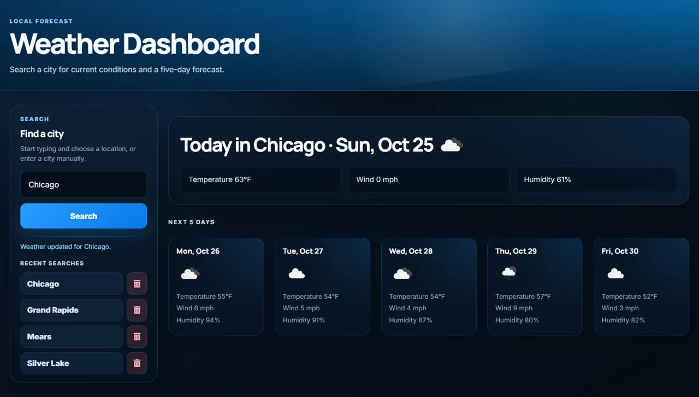

# Weather Dashboard

Search any city and get today's conditions plus a 5-day forecast, with live city autocomplete and a saved search history.

**Live demo:** https://zero9-servers-and-apis.onrender.com
*(Hosted on Render's free tier. If it has been idle, the first load can take up to a minute while the service wakes up.)*



## Features

- Search by city name, with live autocomplete suggestions and keyboard navigation.
- Current conditions plus a 5-day forecast: temperature, humidity, wind speed and weather icon.
- Search history you can click to re-run a search, and delete entries from.
- The OpenWeather API key stays on the server and is never sent to the browser.

## Tech stack

- **Frontend:** TypeScript, Vite, plain DOM (no framework)
- **Backend:** Node.js, Express, TypeScript
- **Data:** [OpenWeather](https://openweathermap.org/api) Geocoding, Current Weather and 5-day Forecast APIs
- **Hosting:** Render (single web service: Express serves the built client)

## Getting started

Requires Node.js 18+ and a free OpenWeather API key.

```bash
git clone https://github.com/PHTMGatt/09-Weather-App.git
cd 09-Weather-App
npm install                  # installs root, server and client dependencies
cp env.example server/.env   # then put your OpenWeather key in server/.env
npm start                    # builds client + server, then serves on http://localhost:3001
```

For development with auto-reload, run `npm run start:dev` (Vite dev server for the client, API on port 3001).

### Environment variables

| Name | Required | Description |
| --- | --- | --- |
| `API_KEY` | yes | Your OpenWeather API key. Without it the API returns a clear "key is not configured" error. |
| `PORT` | no | Port for the Express server. Defaults to `3001`; Render sets it automatically. |

`.env` files are git-ignored. Never commit a real key.

## Deploying to Render

Create a **Web Service** from this repo and set:

- **Build command:** `npm run render-build`
- **Start command:** `npm start`
- **Environment variable:** `API_KEY` = your OpenWeather key

## API

| Method | Route | Purpose |
| --- | --- | --- |
| `GET` | `/api/weather/locations?q=<text>` | City autocomplete suggestions |
| `POST` | `/api/weather` | Weather for `{ cityName }` or `{ lat, lon }` |
| `GET` | `/api/weather/history` | Saved searches |
| `DELETE` | `/api/weather/history/:id` | Remove a saved search |

## Notes

Search history is stored in `server/db/db.json`. That is fine for a demo, but on Render's free tier the file resets on every redeploy and is shared by all visitors.

## Credits

Built by [PHTMGatt](https://github.com/PHTMGatt). Weather data from OpenWeather.

## License

MIT, see [LICENSE](LICENSE).
